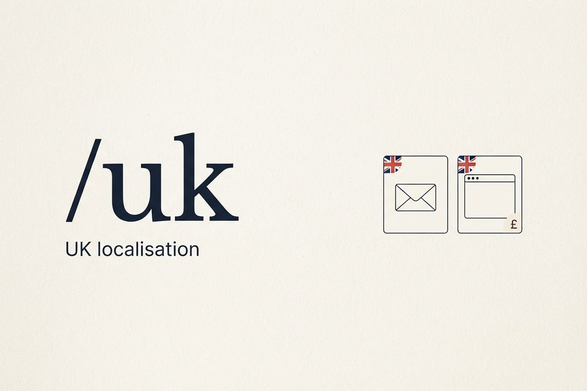
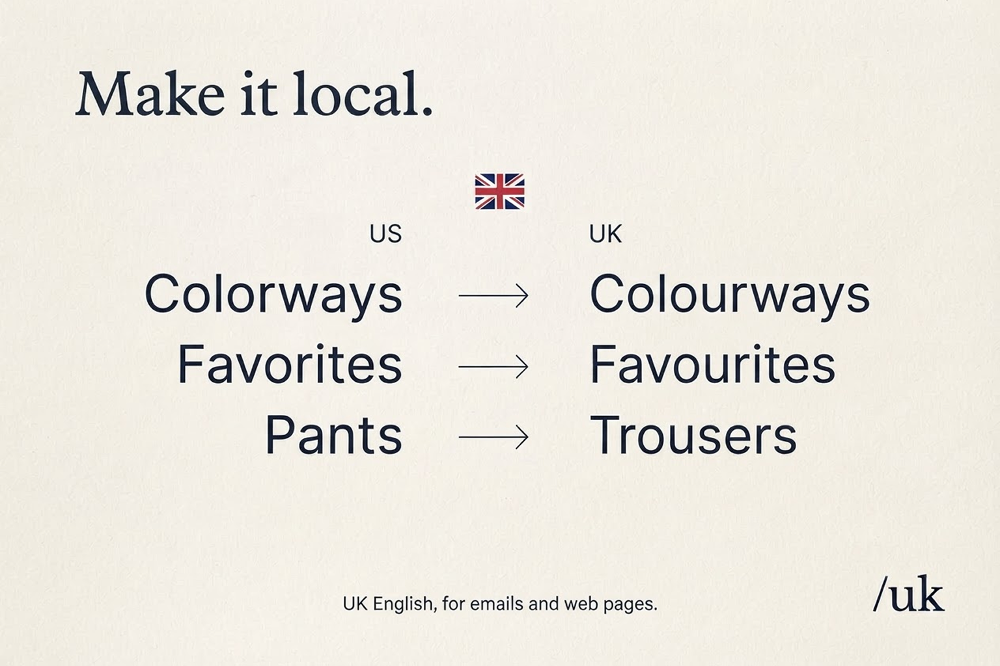
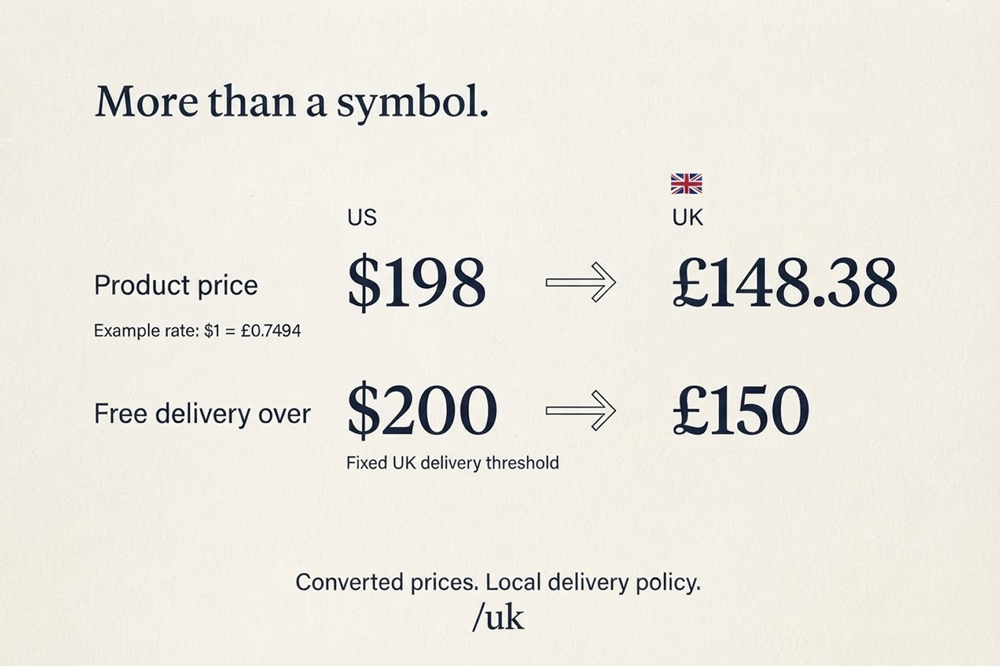

# /uk: an agent skill that makes a UK version of your email or web page

US copy, US prices and US delivery rules do not work on a UK audience. `/uk` takes an email or web page, as a design on a canvas or as code, and makes a UK-localised copy of it. Your original stays untouched.

It is a plain `SKILL.md` file, so it works with any agent that supports skills: Claude Code, the Figma agent, Codex and more. Use it on the design canvas or while vibe coding.

<p align="center">
  
</p>

## What you get

Select an email or web page, run `/uk`, and your agent:

- **Makes a copy and leaves the original alone**: a duplicate beside it on a canvas, or new UK files in code
- **Adapts the wording** from US to natural UK English, keeping meaning and tone
- **Converts prices** from US dollars to British pounds with a real, dated exchange rate, not a swapped symbol
- **Updates the free-delivery message** to the UK threshold of £150
- **Flags anything it should not guess**, such as sizing, tax claims and legal terms
- **Keeps everything else intact**: typography, styling, images and layout on a canvas, and tags, class names, props and links in code

## Canvas or code

`/uk` first works out what it has been given, then follows the matching rules.

| | Canvas design (Figma, Claude Design) | Code (HTML, JSX, templates, i18n files) |
| --- | --- | --- |
| **The copy** | Duplicated beside the original and named "UK email" or "UK web page" | New sibling files, such as `page.uk.html`, or an `en-GB` locale if the project already has i18n |
| **Git** | Not applicable | In a git repo, a `uk-localisation` branch with only the UK files committed. Nothing is pushed. |
| **What changes** | Text on the layers | Visible text only: copy, buttons, labels, alt text, subject lines and preheaders |
| **What never changes** | Typography, styling, images, layout | CSS properties (`color` stays `color`), class names, props, variables, URLs and merge tags such as `{{ first_name }}` |
| **Currency and dates** | Converted prices and £150 in the text | Formatted with `Intl` for `en-GB`, with £150 kept in one named constant |
| **Checked by** | Looking for clipping or overlap | Running the build or tests, and rendering the page if it can |

If you paste plain text with no files, it returns the UK version below the original.

## Preview

Wording changes the way a UK shopper would expect to read it. Clothing "pants" always become "trousers".

<p align="center">
  
</p>

Prices are converted, not relabelled. A $198 product becomes £148.38 at an example rate of $1 = £0.7494, and the free-delivery threshold moves from $200 to a fixed £150.

<p align="center">
  
</p>

## Why

The quick way to localise is to find and replace. It leaves "color" in the headline, puts a £ sign in front of a dollar amount and keeps a $200 delivery threshold that means nothing in the UK. In code it is worse: a blanket replace turns the CSS property `color` into `colour` and breaks the stylesheet. None of it looks broken at first, so it ships.

`/uk` does the whole job and shows its working. It reports the exchange rate, the date and the source, and it marks converted prices as exchange-rate conversions rather than confirmed UK retail prices.

## How it handles prices

- **UK prices you supply win.** If you have approved UK prices, it uses them.
- **Otherwise it converts.** It uses the rate you give it, or the latest dated USD-to-GBP rate from a reliable source. GBP = original USD amount × GBP per USD, rounded once to two decimal places.
- **It never just swaps the symbol.** If you are fixing an earlier symbol-only localisation, it goes back to the original USD amounts, not the relabelled pound amounts.
- **No reliable rate? It asks you for one.**
- **The £150 free-delivery threshold is a supplied policy.** It is not an exchange-rate conversion.

## Install

The skill is one folder: `skills/uk`, containing `SKILL.md`. Put that folder wherever your agent looks for skills.

```bash
git clone https://github.com/JDebDesign/uk-skill.git
```

**Claude Code**

```bash
mkdir -p ~/.claude/skills
cp -R uk-skill/skills/uk ~/.claude/skills/uk
```

Start a new session so it picks the skill up. To use it in a single project only, copy the folder into that project's `.claude/skills/` instead.

**Figma agent**

Install it from [Figma Community](https://www.figma.com/community/skill/163358/uk-localisation).

**Codex and other agents**

Copy `skills/uk` into your agent's skills folder. Check your agent's documentation for where that is. If it does not support skills, paste the contents of `skills/uk/SKILL.md` in as instructions.

## Use

1. Select the email or web-page design, or open the project that contains the code.
2. Run `/uk`, or ask your agent to use the `uk` skill.
3. Review the UK copy. On a canvas your agent links to it. In code it lists the new files, and the branch if it made one. Either way it lists what still needs a human decision.

You can add details in the same message, for example your own exchange rate or approved UK prices.

If your agent asks which one you mean, tell it whether you are working on a design or on code.

## Good to know

- It never edits your original. The UK version is a separate copy, and in code it never overwrites a file.
- In a git repo it only creates a branch and commits its own files. It never pushes, merges or deletes branches, and it never commits your other uncommitted changes.
- It does not invent UK sizes, destinations, addresses, tax claims, legal terms or other commercial policies. It flags them for you to confirm.
- Dates, measurements, sizing, URLs and regional terms are reviewed, and dates use an unambiguous UK format where possible.
- Longer UK copy is checked so it stays readable, with no clipping or overlap.
- In emails it flags the legal footer and unsubscribe text for review instead of rewriting them.
- The skill is a short plain-text file. To change the free-delivery threshold or the wording rules, open `skills/uk/SKILL.md`.

## License

MIT. See [LICENSE](LICENSE).
